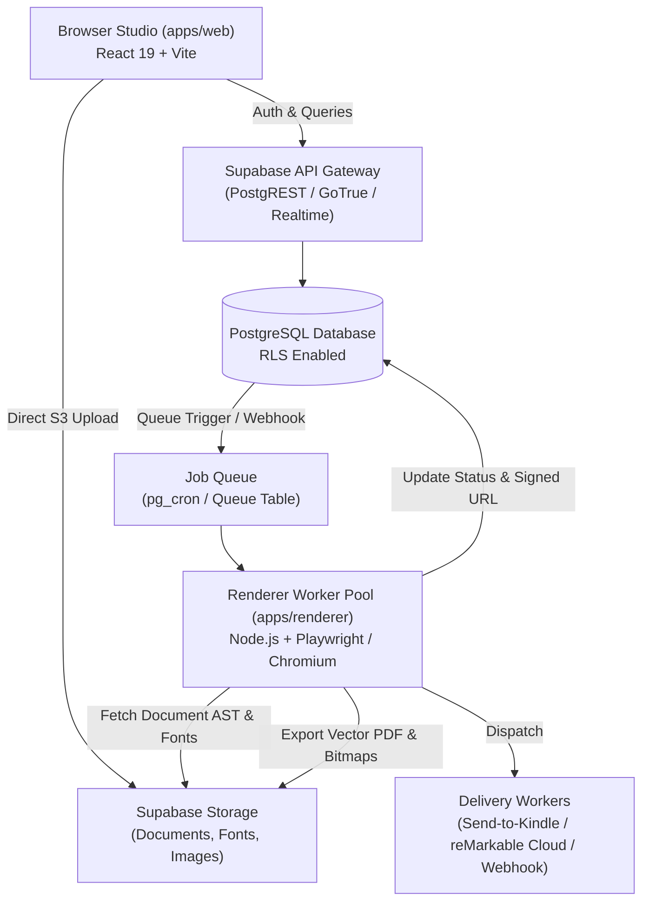

# System Architecture — E-Paper Studio

## 1. High-Level Architecture Overview

E-Paper Studio is architected as a decoupled, event-driven monorepo separating real-time authoring from compute-intensive vector rendering and delivery pipelines.

---

## 2. Monorepo Package Topology

1. **`@epaper-studio/document-schema`**:
   - Single source of truth for the document Abstract Syntax Tree (AST).
   - Validated via Zod schemas.
   - Contains immutable hardware profiles (`kindle-scribe`, `remarkable-2`, `kobo-elipsa`, `print-a4`).

2. **`@epaper-studio/template-engine`**:
   - Compiles layout templates and calculates page breaks.
   - Distributes content across newspaper columns without breaking lines or stranding headers.
   - Generates internal hyperlinked bookmark anchors.

3. **`@epaper-studio/typography`**:
   - Houses font metadata, font face loaders, and unicode script cascades.
   - Normalizes line heights and metrics across Latin, Cyrillic, Arabic, CJK, and Devanagari.
   - Adjusts font weights dynamically based on target DPI (226 vs 300 DPI).

4. **`@epaper-studio/ui`**:
   - Pure UI component library sharing paper aesthetics, contrast inspectors, and zoom tools.

5. **`@epaper-studio/test-fixtures`**:
   - Deterministic documents, device profiles, and mock content fixtures.

---

## 3. Data Model & Supabase Integration

### Core Entities

- `organizations`: Multi-tenant boundary holding members, subscriptions, and quotas.
- `profiles`: User account details, role assignments (Admin, Editor, Viewer).
- `publications`: Periodic titles (e.g., "The Morning Tech Briefing").
- `issues`: Concrete published or draft editions belonging to a publication.
- `templates`: Layout templates specifying grid geometry and block slots.
- `render_jobs`: Asynchronous jobs tracking PDF generation status (`queued`, `rendering`, `completed`, `failed`).
- `subscriptions`: Stripe customer and tier status.

### Security (RLS)

- Every table enforces Row-Level Security.
- Users can only read/write documents belonging to their active organization.
- Storage buckets (`epaper-documents`, `epaper-rendered-pdf`, `epaper-fonts`) use RLS policies matching document ownership.

---

## 4. Headless Rendering Worker (`apps/renderer`)

- **Execution Model**: Containerized Node.js workers listening to pending `render_jobs`.
- **Browser Lifecycle**: Playwright manages a warm pool of headless Chromium browser contexts.
- **Rendering Pipeline**:
  1. Worker claims job via atomic database transaction (`FOR UPDATE SKIP LOCKED`).
  2. Document AST is compiled to semantic HTML+CSS using `@epaper-studio/template-engine` and `@epaper-studio/typography`.
  3. Chromium renders page with exact viewport dimensions matching target device DPI and points.
  4. Vector PDF is emitted via `page.pdf({ printBackground: true, preferCSSPageSize: true })`.
  5. For 1-bit or 16-level grayscale outputs, an optional dithering pass (Floyd-Steinberg canvas worker) produces crisp PNG/e-ink assets.
  6. Output is streamed to Supabase Storage, and the `render_jobs` record is updated with output metadata.

---

## 5. Delivery & Publishing Automation

- **Send-to-Kindle**: SMTP dispatch with authenticated DKIM/SPF sending the generated PDF as an attachment to user's `@kindle.com` address.
- **reMarkable Cloud**: Device synchronization using the reMarkable Cloud REST API.
- **Storage & CDN**: Public publications are served via CDN edge caching with expiring signed URLs for private editions.

---

## 6. Deployment Architecture

- **Web Frontend (`apps/web`)**: Deployed to Vercel, Cloudflare Pages, or AWS CloudFront/S3.
- **Renderer Worker Pool (`apps/renderer`)**: Deployed to container runtimes (AWS ECS Fargate, Google Cloud Run, or Fly.io) with auto-scaling based on queue depth.
- **Database & Storage**: Managed Supabase PostgreSQL with read-replicas and integrated S3-compatible Object Storage.
