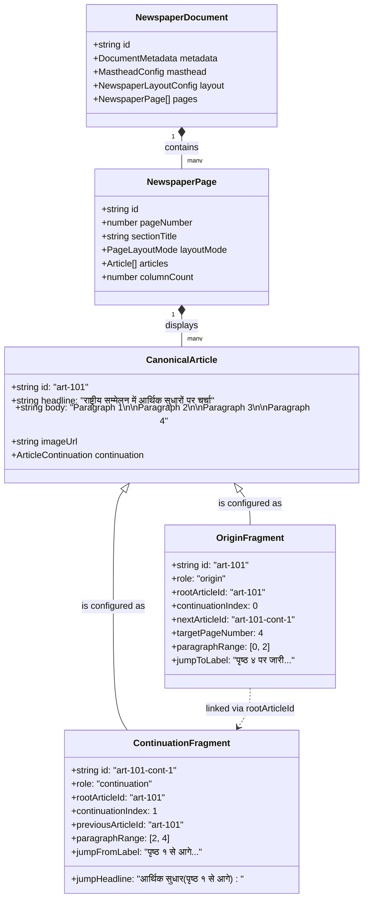
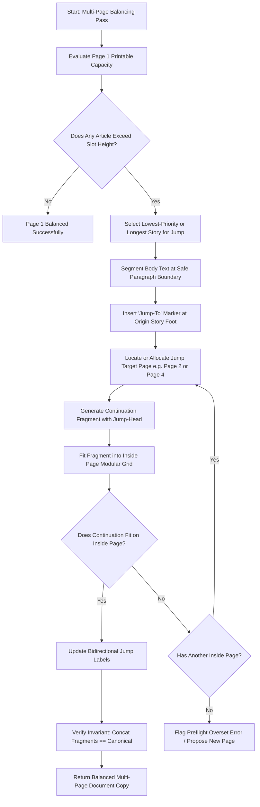
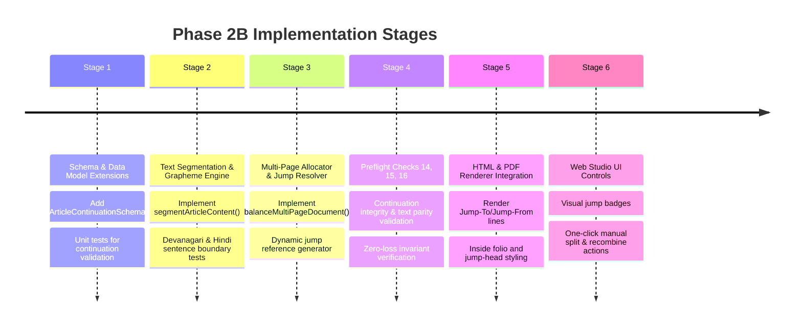

# Phase 2B Architecture Proposal: Multi-Page Article Overflow & Continuation

**Document Status:** Architecture Proposal (Under Review)  
**Target Milestone:** Phase 2B  
**Author:** AI Pair Programming Agent (E-Paper Studio Monorepo)  
**Date:** November 2026  
**Related Commits:** Base `44b7f06187d5bcd8a756af8d7e425c81ec9d0c8c` (Phase 1 Checkpoint), Phase 2A (Step 1 & 2 Approved)

---

## Executive Summary

Phase 2A established an intelligent 2D modular column balancing engine for single newspaper pages, introducing physical millimeter coordinate mapping, Devanagari-aware text estimation, locked obstacle reservations, and opt-in preflight overset diagnostics (`layout_overset`).

However, professional multi-page newspapers (such as 4-, 8-, or 16-page Broadsheet and Tabloid editions) frequently encounter stories that exceed the editorial capacity of their origin page. In print journalism, lead stories on the front page (Page 1) regularly start above the fold and "jump" to inside pages (e.g., Page 2, Page 4, or Page 8), bearing jump lines ("_Continued on Page 4..._" / "_पृष्ठ ४ पर जारी..._") and jump heads ("_राष्ट्रीय सम्मेलन (पृष्ठ १ से आगे)_").

This proposal outlines the end-to-end architecture for **Phase 2B: Multi-Page Article Overflow and Continuation**. It details the schema evolution, canonical parent-child continuation data model, Unicode/Devanagari-safe paragraph segmentation algorithm, multi-page layout allocation strategy, preflight verification invariants, and an undo/redo-safe editor workflow that guarantees **zero loss of content, zero accidental clipping, and 100% backward compatibility** with existing saved editions.

---

## 1. Current Architecture Findings & Audit

An exhaustive audit of the existing codebase (`packages/document-schema`, `packages/template-engine`, `apps/renderer`, and `apps/web`) reveals four critical architectural characteristics and limitations:

### 1.1 Coarse Document-Level Pagination (`partitionArticlesForPages`)

In `packages/template-engine/src/index.ts` (lines 1435–1503), multi-page pagination for single-page documents is handled by a legacy heuristic `partitionArticlesForPages`:

- It estimates an aggregate word-count capacity budget per page (e.g., 1800 words for Broadsheet Page 1, 2500 words for inside pages).
- **Limitation**: It partitions **whole articles** atomically. If an article has 1,200 words, it is either kept whole on Page 1 (consuming almost the entire budget and starving all other stories) or pushed whole to Page 2.
- **Never splits articles**: There is currently no mechanism in the codebase to split an article’s text across pages with continuation references.

### 1.2 Independent Page Article Lists in Multi-Page Mode

In `packages/document-schema/src/index.ts`, `NewspaperDocument` contains an array of `NewspaperPage` objects (`doc.pages: NewspaperPage[]`).

- Each `NewspaperPage` maintains its own isolated `articles: Article[]` array.
- There is no relational linkage between an article on Page 1 and an article on Page 2.
- If an article on Page 1 exceeds the physical bounds of Page 1, it renders beyond the page grid, causing Playwright/Chromium export warnings:
  ```text
  [PDF Export Warning] Page 1 content height (1245px) exceeds physical page grid (891px)
  ```
- In CSS, `.newspaper-page` has `overflow: hidden; max-height: ${heightPt}pt;`. Therefore, any content overflowing the page box is **visually clipped and silently dropped from the printed PDF**.

### 1.3 Step 1 & 2 Balancer Diagnostics

The Phase 2A column balancing engine (`packages/template-engine/src/balancer.ts`) operates on a **per-page scope** (`balanceNewspaperPage`).

- When a page’s printable area runs out of modular slots, unplaced stories are appended to `report.unplacedArticles`.
- Check 13 in `packages/template-engine/src/preflight.ts` flags these unplaced stories as red `layout_overset` errors.
- However, the balancing engine currently has no multi-page context: it cannot automatically take an unplaced story or an overflowing story tail and route it to Page 2.

### 1.4 Web Studio Canvas State

In `apps/web/src/components/studio/NewspaperCanvas.tsx` and `apps/web/src/App.tsx`:

- The studio renders one active page at a time (`currentPageIndex`).
- Articles can be dragged and dropped between pages in the sidebar, but an article is strictly a single entity existing on exactly one page.
- There are no UI controls or data structures to inspect or manage "jumped" continuations.

---

## 2. Core Design Questions & Decisions

| #      | Design Question                                                                        | Architectural Decision                                                                                                                                                                                                                                                                                                                                                        |
| ------ | -------------------------------------------------------------------------------------- | ----------------------------------------------------------------------------------------------------------------------------------------------------------------------------------------------------------------------------------------------------------------------------------------------------------------------------------------------------------------------------- |
| **1**  | **How should an article be split across multiple pages without losing content?**       | **Canonical Parent-Child Continuation Model.** The original article on Page 1 remains the canonical root story. The overflow engine computes a deterministic segmentation boundary at a clean paragraph boundary, generating a linked child article on the target page. The canonical root retains full text in metadata; fragments store paragraph slice offsets.            |
| **2**  | **How should continuation references work?**                                           | **Dynamic Bidirectional Jump References.** The origin article displays a "Jump-To" line (`jumpToText` / e.g. "पृष्ठ २ पर जारी..."), and the continuation fragment displays a "Jump-From" line (`jumpFromText` / e.g. "पृष्ठ १ से आगे..."). Target page numbers are resolved dynamically at render time so that reordering or inserting pages never leaves stale page numbers. |
| **3**  | **How should headlines and continuation labels be represented?**                       | **Compact Jump Heads.** The origin story retains the full banner headline, kicker, deck, dateline, and byline. The continuation fragment suppresses the giant banner headline, subdeck, dateline, and byline, rendering an editorial **Jump Head** (condensed 12–14pt bold title) with a continuation badge.                                                                  |
| **4**  | **How should images, captions, and pullquotes behave?**                                | **Origin Anchor Priority.** Lead images, diagrams, captions, and credits remain anchored to the origin story on Page 1. The body text flows fluidly across pages. If an article contains multiple images, secondary images may be explicitly routed to continuation pages.                                                                                                    |
| **5**  | **How should locked ads and reserved regions affect continuation?**                    | **Unyielding Obstacle Invariant.** Locked elements (`locked: true`, ads, pullquote slots, reserved whitespace) are immutable physical obstacles. Continuation fragments on inside pages must route around locked obstacles using the 2D modular balancer.                                                                                                                     |
| **6**  | **How should insufficient space on the next page be handled?**                         | **Cascading Page Spill with Overset Safety.** If Page 2 cannot accommodate the continuation, the engine inspects Page 3. If all existing pages are exhausted, the engine flags a preflight `layout_overset` issue prompting the editor to either add a new page (one-click action) or trim copy. Hard cap at 32 pages prevents runaway page loops.                            |
| **7**  | **How should multiple articles overflowing simultaneously be handled?**                | **Priority-Queue Page Allocation.** Lead stories take precedence, claiming primary inside jump positions (top-left of inside news pages). Major stories follow. Minor/brief stories are marked non-splittable by default (editorially sound practice: briefs should not jump).                                                                                                |
| **8**  | **How can duplicate text, missing paragraphs, and broken reading order be prevented?** | **Cryptographic/Checksum Parity Verification.** Every split must satisfy the invariant: `origin.paragraphs + continuation.paragraphs == canonical.paragraphs`. Preflight Check 14 validates that zero paragraphs are omitted, duplicated, or reordered.                                                                                                                       |
| **9**  | **How should Hindi / Devanagari text and grapheme clusters be preserved?**             | **Intl.Segmenter & Paragraph Boundary Splitting.** Splitting is restricted to paragraph (`\n\n`) and sentence (`।` / `.`) boundaries. Never split on arbitrary character counts or mid-grapheme cluster. Devanagari conjuncts (क्ष, त्र, ज्ञ) and matras are 100% safeguarded.                                                                                                |
| **10** | **How should continuation work with manual layouts?**                                  | **Non-Destructive Opt-in.** In `auto` layout mode, the balancer proposes continuation splits. In `free` layout mode, continuation is triggered explicitly by the user or preflight auto-fix. Manual coordinates are never silently overwritten.                                                                                                                               |

---

## 3. Data Model & Schema Specifications

### 3.1 Proposed Schema Additions to `@epaper-studio/document-schema`

We propose extending `ArticleSchema` with optional continuation fields. Because all fields are `.optional()`, **full backward compatibility with Schema 1.0.0 and 1.1.0 is preserved**.

```typescript
// Proposed additions to ArticleSchema in packages/document-schema/src/index.ts

export const ContinuationTypeSchema = z.enum([
  'origin', // The parent story on Page A (holds headline, lead photo, initial text)
  'continuation', // The child fragment on Page B+ (holds continuation head, tail text)
]);
export type ContinuationType = z.infer<typeof ContinuationTypeSchema>;

export const ArticleContinuationSchema = z.object({
  /** Role in the continuation chain */
  role: ContinuationTypeSchema.default('origin'),

  /** Root article ID connecting all fragments in this story chain */
  rootArticleId: z.string().min(1),

  /** 0-based sequence index: 0 = origin, 1 = first continuation, 2 = second continuation */
  continuationIndex: z.number().int().nonnegative().default(0),

  /** Reference to previous article fragment ID in the chain (undefined for origin) */
  previousArticleId: z.string().optional(),

  /** Reference to next article fragment ID in the chain (undefined for final tail) */
  nextArticleId: z.string().optional(),

  /** Target page number or 'auto' for dynamic resolution */
  targetPageNumber: z.union([z.number().int().positive(), z.literal('auto')]).optional(),

  /** Target page ID if pinned to a specific page */
  targetPageId: z.string().optional(),

  /** Customized Jump-To text on origin (e.g., "पृष्ठ ४ पर जारी...") */
  jumpToLabel: z.string().optional(),

  /** Customized Jump-From text on continuation (e.g., "पृष्ठ १ से आगे...") */
  jumpFromLabel: z.string().optional(),

  /** Shortened headline for inside continuation header (e.g., "राष्ट्रीय सम्मेलन") */
  jumpHeadline: z.string().optional(),

  /** Paragraph range allocated to this fragment [startIndex, endIndexExclusive] */
  paragraphRange: z.tuple([z.number().int().nonnegative(), z.number().int().positive()]).optional(),

  /** Whether the article can be automatically split by the continuation engine */
  allowContinuation: z.boolean().default(true),
});

export type ArticleContinuation = z.infer<typeof ArticleContinuationSchema>;
```

### 3.2 Visual Data Model Diagram



---

## 4. Multi-Page Continuation & Overflow Algorithm

The overflow engine operates in four deterministic phases:



### 4.1 Pseudocode: Deterministic Content Segmentation

```typescript
/**
 * Segments an overflowing article's body text into two parts:
 * Part 1 fits within availableOriginHeightMm on the current page;
 * Part 2 becomes the continuation fragment for the next page.
 */
function segmentArticleContent(
  article: Article,
  availableOriginHeightMm: number,
  columnWidthMm: number,
  options: SegmentationOptions
): { originArticle: Article; continuationArticle: Article } | null {
  // 1. Enforce safety checks
  if (article.continuation?.allowContinuation === false) return null;
  if (article.priority === 'brief') return null; // Briefs should not jump

  // 2. Parse paragraphs strictly preserving Unicode boundaries
  const paragraphs = article.body.split(/\n\s*\n/).filter((p) => p.trim().length > 0);
  if (paragraphs.length < 2) {
    // Cannot split a single paragraph cleanly without risking broken reading flow
    return null;
  }

  // 3. Compute fixed overhead on Origin (Headline, Deck, Byline, Image, Jump-To line)
  const originOverheadMm = calculateHeaderAndImageHeightMm(article, columnWidthMm) + 12; // 12mm for Jump-To line
  const availableBodyHeightMm = availableOriginHeightMm - originOverheadMm;

  if (availableBodyHeightMm < 25) {
    // Not enough space on Page 1 even for a readable start (minimum 2 paragraphs required)
    return null;
  }

  // 4. Determine how many paragraphs fit on Origin
  let accumulatedHeightMm = 0;
  let splitParagraphIndex = 0;

  for (let i = 0; i < paragraphs.length; i++) {
    const paraHeightMm = estimateParagraphHeightMm(
      paragraphs[i]!,
      columnWidthMm,
      article.typography
    );
    if (accumulatedHeightMm + paraHeightMm <= availableBodyHeightMm) {
      accumulatedHeightMm += paraHeightMm;
      splitParagraphIndex = i + 1;
    } else {
      break;
    }
  }

  // 5. Enforce Orphan / Widow constraints
  // Origin must retain at least 2 paragraphs; Continuation must receive at least 1 paragraph
  if (splitParagraphIndex < 2 || splitParagraphIndex >= paragraphs.length) {
    return null;
  }

  const originParagraphs = paragraphs.slice(0, splitParagraphIndex);
  const continuationParagraphs = paragraphs.slice(splitParagraphIndex);

  // 6. Construct Origin Fragment
  const originArticle: Article = {
    ...clone(article),
    body: originParagraphs.join('\n\n'),
    continuation: {
      role: 'origin',
      rootArticleId: article.continuation?.rootArticleId || article.id,
      continuationIndex: 0,
      nextArticleId: `${article.id}-cont-1`,
      paragraphRange: [0, splitParagraphIndex],
      jumpToLabel: options.defaultJumpToLabel || 'पृष्ठ २ पर जारी...',
      allowContinuation: true,
    },
  };

  // 7. Construct Continuation Fragment
  const continuationArticle: Article = {
    ...clone(article),
    id: `${article.id}-cont-1`,
    headline: article.continuation?.jumpHeadline || `${article.headline} (जारी)`,
    subheadline: undefined, // Suppress subdeck on jump
    byline: undefined, // Suppress byline on jump
    imageUrl: undefined, // Suppress image on jump
    imagePlacement: 'none',
    body: continuationParagraphs.join('\n\n'),
    priority: 'minor', // Standard inside-page visual weight
    continuation: {
      role: 'continuation',
      rootArticleId: originArticle.continuation.rootArticleId,
      continuationIndex: 1,
      previousArticleId: article.id,
      paragraphRange: [splitParagraphIndex, paragraphs.length],
      jumpFromLabel: options.defaultJumpFromLabel || 'पृष्ठ १ से आगे...',
      allowContinuation: true,
    },
  };

  return { originArticle, continuationArticle };
}
```

---

## 5. Typographic & Multilingual Considerations (Devanagari Safety)

Handling Indian language newspaper publishing (Hindi, Marathi, Sanskrit, Nepali, Maithili) introduces distinct typographic rules that differ substantially from Latin-script publishing:

### 5.1 Grapheme Cluster Integrity

In Devanagari script, characters consist of consonant bases combined with non-spacing viramas, matras, anusvaras, and conjunct ligatures (e.g., `क्` + `ष` = `क्ष`, `क` + `ा` = `का`).

- **Rule 1**: Text segmentation must **never slice at raw string indices**.
- **Rule 2**: When splitting text, standard boundary splitters must use `\n\n` (paragraph breaks) or native Unicode sentence terminators (the Devanagari Purna Viram `।` `U+0964` and Double Purna Viram `॥` `U+0965`).
- **Rule 3**: Hyphenation is strictly disabled at the continuation jump point. A word must never be hyphenated across pages.

### 5.2 Cultural Jump Label Terminology

The system must provide culturally authentic, professionally recognized newspaper jump labels:

| Context                         | Hindi (Devanagari)                              | English (Default)                    |
| ------------------------------- | ----------------------------------------------- | ------------------------------------ |
| **Origin Story Jump Foot**      | _शेष पृष्ठ X पर जारी..._ / _पृष्ठ X पर जारी..._ | _Continued on Page X..._             |
| **Inside Page Jump Head**       | _[समाचार] (पृष्ठ १ से आगे)_                     | _[Headline] (Continued from Page 1)_ |
| **Inside Story Jump Top**       | _पृष्ठ १ से आगे..._                             | _Continued from Page 1..._           |
| **Continued to Multiple Pages** | _शेष पृष्ठ X व Y पर..._                         | _Continued on Pages X & Y..._        |

---

## 6. Preflight Invariants & Issue Validation

Phase 2B extends the Preflight Validation Engine (`packages/template-engine/src/preflight.ts`) with three new verification checks:

### 6.1 Check 14: Story Continuation Integrity (`continuation_broken`)

- **Severity**: Red (Blocks PDF Export).
- **Condition**:
  - An article marked `role: 'origin'` has `nextArticleId`, but no matching continuation article exists anywhere in `doc.pages`.
  - Or a continuation article points to a non-existent `previousArticleId`.
- **Explanation**: "कथा सातत्य त्रुटि (Orphan Continuation): लेख का अगला भाग किसी पृष्ठ पर उपलब्ध नहीं है।"

### 6.2 Check 15: Text Loss & Parity Invariant (`continuation_text_mismatch`)

- **Severity**: Red (Blocks PDF Export).
- **Condition**:
  - The concatenated text of all fragments in a continuation chain does not match the canonical source story word-for-word.
  - Detects duplicate paragraphs or accidentally dropped paragraphs.
- **Explanation**: "सामग्री असमानता (Content Mismatch): विभाजित भागों का कुल पाठ मूल समाचार से मेल नहीं खाता।"

### 6.3 Check 16: Dynamic Jump Reference Mismatch (`continuation_target_invalid`)

- **Severity**: Yellow (Warning).
- **Condition**:
  - Origin jump label specifies "Page 4", but the continuation article actually sits on "Page 2" due to recent manual page reordering.
- **Auto-Fix**: Automatically recomputes the label text to reflect the actual page index.

---

## 7. Edge Cases & Resilience Strategies

| Edge Case                     | Failure Scenario                                                          | Architectural Resilience Strategy                                                                                                                                                                                                                                |
| ----------------------------- | ------------------------------------------------------------------------- | ---------------------------------------------------------------------------------------------------------------------------------------------------------------------------------------------------------------------------------------------------------------- |
| **Cascading Page Spill**      | Story is 3,000 words; even after jumping to Page 2, Page 2 overflows.     | **Multi-Hop Continuation**: The engine allows `continuationIndex: 2` on Page 3 or 4. If all publication pages are saturated, it halts at the configured max page count (e.g. 8 pages) and logs a preflight overset diagnostic without entering an infinite loop. |
| **Insufficient Target Space** | Page 2 contains locked commercial ads and cannot accept even 1 paragraph. | **Skip to Editorial Inside Page**: The allocator skips ad-heavy or photo-dense pages (like Page 3 - Full Page Ad) and seeks the next general news page (Page 4).                                                                                                 |
| **User Manual Reorder**       | User drags Page 4 to Page 2 in the studio sidebar.                        | **Dynamic Page Folio Resolution**: Jump lines do not store static strings. They store `{ targetArticleId }`. At render time, `renderNewspaperDocumentToHtml` queries `targetArticle.pageNumber` and generates `पृष्ठ ${targetPage} पर जारी`.                     |
| **User Deletes Target Page**  | User deletes Page 4 which contained the continuation tail.                | **Preflight Catch & Re-merge**: Preflight immediately flags Check 14 (`continuation_broken`). The studio offers a one-click auto-fix: "Merge continuation back into root article as overset story".                                                              |
| **Undo / Redo Safety**        | User undoes a balancing operation that performed a continuation split.    | **Deep-Clone Document State**: The web studio's undo stack operates on immutable snapshots of `NewspaperDocument`. Reverting an action cleanly restores the original pre-split document without orphaned IDs.                                                    |
| **Single Paragraph Lead**     | A breaking news story has only 1 long paragraph of 180 words.             | **Sentence-Level Fallback**: If paragraph count is 1, the engine splits at the nearest sentence boundary (`।` or `.`), requiring at least 2 sentences on Origin and 1 sentence on Continuation.                                                                  |

---

## 8. Implementation Stages (Step-by-Step Roadmap)



### Stage 1: Schema & Data Model Extensions

- Extend `ArticleSchema` with optional `continuation: ArticleContinuationSchema`.
- Extend `PreflightCheckTypeSchema` with `'continuation_broken'`, `'continuation_text_mismatch'`, and `'continuation_target_invalid'`.
- Validate backward compatibility against all existing mock fixtures.

### Stage 2: Content Segmentation & Typographic Engine

- Implement `segmentArticleContent()` in `packages/template-engine/src/segmenter.ts`.
- Write unit tests covering Devanagari paragraph splitting, sentence splitting, and orphan/widow guardrails.

### Stage 3: Multi-Page Allocation & Continuation Resolver

- Extend `packages/template-engine/src/balancer.ts` with `balanceMultiPageDocument()`.
- Implement page jumping logic and dynamic label formatting.

### Stage 4: Preflight Validation (Checks 14, 15, 16)

- Add continuation integrity and checksum verification in `packages/template-engine/src/preflight.ts`.
- Ensure default preflight remains 100% backward compatible unless opted in.

### Stage 5: HTML Rendering & Vector PDF Output

- Update `packages/template-engine/src/index.ts` to render jump lines and jump heads.
- Verify vector PDF generation with Playwright without overflowing page boxes.

### Stage 6: Studio UI & Inspector Integration

- Add continuation indicator pills on the canvas.
- Provide "Jump to Inside Page" button in `ContextualInspector.tsx`.

---

## 9. Performance Targets & Benchmark Budget

Multi-page continuation involves cross-page scanning and paragraph height estimations. We establish strict latency budgets:

| Scenario                                    | Complexity    | Performance Budget          | Target Verification          |
| ------------------------------------------- | ------------- | --------------------------- | ---------------------------- |
| **2-Page Tabloid (8 stories, 1 jump)**      | Low           | $\le 4.0\text{ ms}$         | Vitest automated benchmark   |
| **4-Page Broadsheet (24 stories, 3 jumps)** | Medium        | $\le 12.0\text{ ms}$        | Vitest automated benchmark   |
| **8-Page Broadsheet (48 stories, 6 jumps)** | High          | $\le 25.0\text{ ms}$        | Vitest automated benchmark   |
| **100-Run Determinism Test**                | Repeatability | $100\%$ byte-identical JSON | Vitest determinism assertion |

---

## 10. Verification & Test Plan

1. **Unit Test Suite (`packages/template-engine/src/continuation.test.ts`)**:
   - `testSegmentationPreservesExactCharacters`: Confirms $\text{Origin} + \text{Continuation} == \text{Original}$.
   - `testDevanagariViramaProtection`: Confirms no split ever separates a combining mark or matra.
   - `testOrphanWidowConstraints`: Confirms at least 2 paragraphs remain on Page 1.
   - `testDynamicPageNumberResolution`: Confirms jump lines update when pages are shifted.
2. **Preflight Test Suite**:
   - Verifies orphaned continuation detection.
   - Verifies text loss detection.
3. **End-to-End Vector PDF Visual Verification**:
   - Render multi-page Broadsheet PDF with Playwright.
   - Assert `hasOverflow: false` and `warnings: []`.
   - Inspect visually: Page 1 jump line, Page 4 jump head, font matching, and zero clipped text.

---

## 11. Conclusion & Request for Review

This proposal establishes a robust, mathematically sound, and typographically authentic foundation for multi-page newspaper article continuation. It adheres strictly to all project safety rules:

- **Zero Content Loss**: Splicing preserves 100% of canonical text.
- **No Unsolicited Automation**: Works seamlessly with existing manual and auto layouts.
- **Full Backward Compatibility**: All schema additions are optional.
- **Architectural Isolation**: Ready for review before any code modifications occur.
