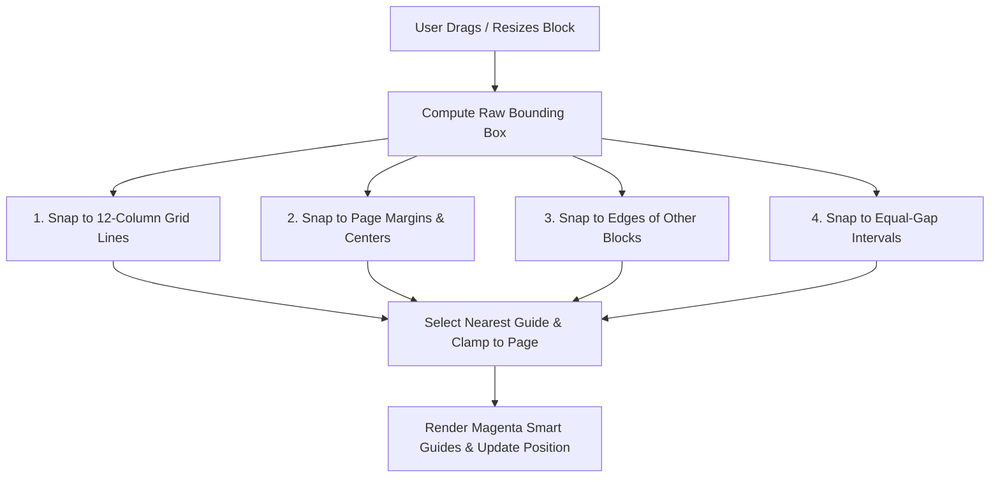

# Free-Placement Layout Mode — Architectural Design Specification

**Document Status:** Architecture & Design Specification (Read-Only Proposal)  
**Author:** Antigravity Senior Engineering Team  
**Date:** 2026-10-29  
**Target Milestone:** E-Paper Studio — Phase 2/3 Free-Form Layout Engine  
**Target File:** `docs/free-layout-design.md`  

---

## 1. Executive Summary & Goals

Currently, E-Paper Studio uses an **auto-flow CSS Grid layout** where articles occupy discrete column spans (1 to 12) within an automated document flow. Content wraps down the page row by row based on `orderIndex`.

While this model is robust for structured periodicals, professional newspaper designers and e-paper publishing houses require **free-placement layout (desktop publishing / CAD-style)**:
1. **Unconstrained Placement**: Users can drag and position any block anywhere on a fixed-size page (left, right, top, bottom, corners, or custom floating coordinates).
2. **Interactive Manipulation**: Direct block swapping, 8-point bounding-box resizing, and multi-axis alignment.
3. **Strict Page Boundary Clamping**: The page geometry is fixed; blocks and their contents **can never overflow or extend beyond physical printable page margins**.
4. **Millimeter-Level WYSIWYG Parity**: The interactive React editor and the headless Playwright vector PDF export engine utilize **identical absolute physical positions in millimeters (`mm`)**, ensuring bounding-box parity within **$\le 0.5\text{ mm}$**.

This document outlines the end-to-end design for introducing this capability without regressing or breaking existing auto-flow publications.

---

## 2. Document Schema & Architecture Impact Analysis

### 2.1 Coordinate Model: `frame { x, y, w, h }` in Millimeters

To maintain true physical fidelity across differing display densities (DPI) and paper sizes (Broadsheet, Berliner, Tabloid, A3, A4), coordinates are specified in **millimeters (`mm`)**:

```typescript
export interface FrameMm {
  /** Horizontal offset in mm from the printable content area's left edge */
  x: number;
  /** Vertical offset in mm from the printable content area's top edge */
  y: number;
  /** Width of the block frame in mm */
  w: number;
  /** Height of the block frame in mm */
  h: number;
  /** Stacking order for overlapping blocks (default: 0) */
  zIndex?: number;
}
```

#### Coordinate Space Origin Rule
The origin `(x = 0, y = 0)` represents the **top-left corner of the printable content area** (inside page margins, and directly below the masthead on Page 1 or running folio header on Page 2+).

$$\begin{aligned}
x_{\text{canvas}} &= \text{margin}_{\text{left}} + x \\
y_{\text{canvas}} &= \text{header}_{\text{bottom}} + y \\
x + w &\le W_{\text{content}} \\
y + h &\le H_{\text{content}}
\end{aligned}$$

This isolates block positioning from global page margins or masthead style adjustments.

---

### 2.2 Inventory of Affected Files and Functions

| Module / File | Current Responsibility | Required Modifications for Free-Placement |
| :--- | :--- | :--- |
| **`packages/document-schema/src/index.ts`** | Zod schemas for `Article`, `NewspaperPage`, `NewspaperDocument` | - Add `FrameMmSchema` (`x, y, w, h, zIndex`).<br/>- Add optional `frame: FrameMmSchema.optional()` to `ArticleSchema`.<br/>- Add `layoutMode: z.enum(['auto', 'free']).default('auto')` to `NewspaperPageSchema`.<br/>- Update `NewspaperDocumentSchema` version to `'1.1.0'`. |
| **`packages/template-engine/src/index.ts`** | Grid calculations and HTML/CSS generation (`renderNewspaperDocumentToHtml`) | - Support `page.layoutMode === 'free'`.<br/>- For free pages, render articles with `position: absolute; left: ${frame.x}mm; top: ${frame.y}mm; width: ${frame.w}mm; height: ${frame.h}mm; overflow: hidden;`.<br/>- Calculate exact printable content area height ($H_{\text{content}}$) minus header and footer metrics.<br/>- Add conversion helper `convertPageAutoToFree()` and `convertPageFreeToAuto()`. |
| **`apps/web/src/components/studio/NewspaperCanvas.tsx`** | Canvas editor layout, drag-over ghost, article card rendering | - Introduce conditional rendering for `free` pages (replacing `display: grid` with `position: relative` canvas).<br/>- Integrate drag-and-resize bounding boxes and 8 resize handles.<br/>- Add visual alignment guide lines and snapping overlays.<br/>- Implement `screenToPageMm()` pointer interaction for dragging and resizing. |
| **`apps/web/src/components/studio/ContextualInspector.tsx`** | Property inspector for selected article | - When on a `free` page, render the **"Position & Dimensions"** panel (`X`, `Y`, `W`, `H` inputs with mm step controls).<br/>- Add alignment toolbars (Align Left, Right, Top, Bottom, Center X, Center Y).<br/>- Add Nudge controls ($\pm 0.5\text{ mm}$, $\pm 1\text{ mm}$, $\pm 5\text{ mm}$). |
| **`apps/web/src/utils/presetPlacement.ts`** | Factory for instantiating preset blocks (`createArticleFromPreset`) | - Support `free` mode: when inserting into a free-layout page, find the nearest unoccupied slot ($x, y, w, h$) via 2D bin packing rather than appending to flow. |
| **`apps/renderer/src/index.ts`** | Playwright Chromium vector PDF worker | - No rendering changes required (CSS `pt`/`mm` absolute positioning is natively supported by Chromium print mode).<br/>- Add post-render overflow assertion hook to detect clipped text in export pipelines. |

---

## 3. Migration & Hybrid Layout Plan

### 3.1 Per-Page Hybrid Architecture (`layoutMode: 'auto' | 'free'`)

Publications frequently require **mixed layouts**:
- **Page 1 (Front Page)**: `layoutMode: 'free'` — highly artistic, custom hero lead placement, floating callout boxes, and irregular sponsor placements.
- **Pages 2–4 (Inside Editorial & News)**: `layoutMode: 'auto'` — structured 12-column multi-column flow for high-volume text density.

The layout mode is therefore stored **per page** in `NewspaperPageSchema`:

```typescript
export const NewspaperPageSchema = z.object({
  id: z.string().min(1),
  pageNumber: z.number().int().positive(),
  sectionTitle: z.string().optional().default('मुख्य पृष्ठ'),
  layoutMode: z.enum(['auto', 'free']).default('auto'),
  columnCount: z.number().int().min(2).max(12).optional(),
  articles: z.array(ArticleSchema).default([]),
});
```

### 3.2 Schema Versioning (`1.0.0` $\to$ `1.1.0`)

Backward compatibility is guaranteed:
- If a document has `version: "1.0.0"` or lacks `layoutMode`, `getPublicationPages()` automatically assigns `layoutMode: 'auto'`.
- Any article without a `frame` object rendered on a `free` page is assigned a computed frame via fallback on first load.

---

### 3.3 Conversion Algorithms

#### A. Auto $\to$ Free ("Break into Free Layout")
Converts automated column-grid articles into explicit physical millimeter coordinates:

```typescript
export function convertPageAutoToFree(
  page: NewspaperPage,
  metrics: PhysicalPageMetrics,
  headerHeightMm: number
): NewspaperPage {
  const contentWidthMm = metrics.contentWidthMm;
  const colCount = page.columnCount ?? 12;
  const gapMm = (metrics.gapPt * 25.4) / 72;
  const singleColWidthMm = (contentWidthMm - (colCount - 1) * gapMm) / colCount;

  let currentXCol = 0;
  let currentRowTopMm = 0;
  let currentRowMaxHeightMm = 0;

  const freeArticles = page.articles.map((art) => {
    const span = Math.min(colCount, Math.max(1, art.columnSpan));

    // Wrap to next row if span exceeds remaining columns
    if (currentXCol + span > colCount) {
      currentRowTopMm += currentRowMaxHeightMm + gapMm;
      currentXCol = 0;
      currentRowMaxHeightMm = 0;
    }

    const xMm = currentXCol * (singleColWidthMm + gapMm);
    const wMm = span * singleColWidthMm + (span - 1) * gapMm;
    
    // Estimate or measure height based on text content and image
    const hMm = art.frame?.h ?? estimateBlockHeightMm(art, wMm, metrics);

    currentRowMaxHeightMm = Math.max(currentRowMaxHeightMm, hMm);
    currentXCol += span;

    return {
      ...art,
      frame: {
        x: Number(xMm.toFixed(2)),
        y: Number(currentRowTopMm.toFixed(2)),
        w: Number(wMm.toFixed(2)),
        h: Number(hMm.toFixed(2)),
        zIndex: 1,
      },
    };
  });

  return {
    ...page,
    layoutMode: 'free',
    articles: freeArticles,
  };
}
```

#### B. Free $\to$ Auto ("Auto-Arrange / Snap into Columns")
Normalizes free-floating blocks back into sequential 12-column flow:

1. **Topological Sort**: Sort blocks primarily by vertical center $Y_{\text{center}}$ (top to bottom) with a row-clustering tolerance of $\pm 10\text{ mm}$, and secondarily by horizontal position $X$ (left to right).
2. **Column-Span Projection**: Project width $w_{\text{mm}}$ onto nearest integer column span:
   $$\text{span} = \text{clamp}\left(1, 12, \text{round}\left(\frac{w_{\text{mm}} + \text{gap}_{\text{mm}}}{\text{singleColWidth}_{\text{mm}} + \text{gap}_{\text{mm}}}\right)\right)$$
3. **Preserve Metadata**: Retain the existing `frame` property as metadata so users can toggle back to Free mode without loss of precision.

---

## 4. Collision & Placement Strategies

### 4.1 Swap-on-Drop (Default Behavior)

When dragging Block $A$ over an existing Block $B$:
- **Trigger Condition**: Intersection over Area ($\text{IoA} \ge 40\%$) or pointer center inside Block $B$'s bounding box.
- **Identical Dimensions**: $A$ assumes $B$'s $(x, y)$, and $B$ assumes $A$'s original $(x, y)$.

#### Handling Different-Sized Blocks (Edge Cases)
When Block $A$ ($80 \times 40\text{ mm}$) and Block $B$ ($160 \times 120\text{ mm}$) are swapped:
1. **Anchor Position Swap**:
   $$x_A' = x_B, \quad y_A' = y_B$$
   $$x_B' = x_A, \quad y_B' = y_A$$
2. **Boundary Clamping**:
   If $x_B' + w_B > W_{\text{content}}$, clamp: $x_B' = W_{\text{content}} - w_B$.
   If $y_B' + h_B > H_{\text{content}}$, clamp: $y_B' = H_{\text{content}} - h_B$.
3. **Secondary Overlap Detection**:
   If relocating the larger Block $B$ to $A$'s position causes a collision with a third Block $C$:
   - **Displacement Strategy**: Shift Block $C$ downward if space exists.
   - **Rejection Fallback**: If secondary collision cannot be resolved within bounds, abort swap, trigger a visual shake animation on Block $B$, and notify: `"Cannot swap: insufficient space for larger block without collision."`

---

### 4.2 Reject-Overlap Mode

In dense editorial layouts, users can enable **"Strict Non-Overlapping"**:
- Uses 2D Axis-Aligned Bounding Box (AABB) intersection:
  $$\text{Overlap}(A, B) \iff (x_A < x_B + w_B) \land (x_A + w_A > x_B) \land (y_A < y_B + h_B) \land (y_A + h_A > y_B)$$
- During drag: While overlapping, target outline highlights in warning crimson (`#ef4444`).
- Upon release: Block smoothly transitions back to its initial $(x, y)$ position using a spring curve.

---

### 4.3 Nearest-Free-Slot Search (For "Add Block")

When a user clicks "+ Add Block" from the Elements Panel:

```typescript
export function findNearestFreeSlot(
  page: NewspaperPage,
  blockWidthMm: number,
  blockHeightMm: number,
  contentWidthMm: number,
  contentHeightMm: number,
  stepMm: number = 5
): { x: number; y: number } | null {
  // Discretize search space in stepMm increments
  for (let y = 0; y <= contentHeightMm - blockHeightMm; y += stepMm) {
    for (let x = 0; x <= contentWidthMm - blockWidthMm; x += stepMm) {
      const candidate = { x, y, w: blockWidthMm, h: blockHeightMm };
      const hasCollision = page.articles.some((art) => {
        if (!art.frame) return false;
        return checkAabbOverlap(candidate, art.frame);
      });

      if (!hasCollision) {
        return { x, y };
      }
    }
  }
  return null; // Page is full! Clamping prevents off-page placement.
}
```

If `findNearestFreeSlot` returns `null`, the UI displays: `"Page content area is full. Please resize existing elements or add a new page."`

---

## 5. Snapping Engine & Guide Geometry

The snapping engine evaluates coordinates on every drag/resize frame. When candidate delta $|\Delta| \le \text{threshold}$, the coordinate snaps to the guide.

$$\text{threshold}_{\text{mm}} = \frac{8\text{ px}}{\text{zoomFactor} \times \frac{96\text{ px}}{25.4\text{ mm}}}$$

*(At 100% zoom, 8px threshold $\approx 2.1\text{ mm}$. At 50% zoom, threshold scales to $\approx 4.2\text{ mm}$ for comfortable target acquisition).*



### Snap Guides Taxonomy
1. **12-Column Horizontal Guides**:
   $X = k \cdot (C_{\text{col}} + G_{\text{gap}})$ (left edge) and $X = k \cdot (C_{\text{col}} + G_{\text{gap}}) + C_{\text{col}}$ (right edge).
2. **Page Boundaries & Center**:
   $X = 0$, $X = W_{\text{content}} / 2$, $X = W_{\text{content}}$.
   $Y = 0$, $Y = H_{\text{content}} / 2$, $Y = H_{\text{content}}$.
3. **Sibling Alignment**:
   Left-to-Left, Right-to-Right, Top-to-Top, Bottom-to-Bottom, Center-X, Center-Y.
4. **Equal-Gap Distances (Smart Spacing)**:
   When distance between Block $A$ and $B$ equals the document's column gap ($G_{\text{gap}}$) or the distance between $B$ and $C$, snap and show gap dimension callouts ($4.9\text{ mm}$).

---

## 6. Text Fit, Auto-Shrink & Devanagari Typography Constraints

### 6.1 Overflow Detection

In free layout, frame height $h$ is fixed. If editorial text exceeds the frame volume:

#### Editor-Side Detection
```typescript
const isOverflowing = 
  element.scrollHeight > element.clientHeight + 1 ||
  element.scrollWidth > element.clientWidth + 1;
```
When true:
- Display red dashed border on frame bottom: `border-bottom: 2px dashed #dc2626`.
- Show floating status badge: `"⚠️ सामग्री सीमा से बाहर (+2 पंक्तियाँ)"` (`+2 lines overflow`).

#### PDF Renderer Detection (Headless Playwright Worker)
During vector PDF export in `apps/renderer`, the worker queries DOM layout nodes:
```typescript
const overflowReport = await page.evaluate(() => {
  return Array.from(document.querySelectorAll('.newspaper-article')).map((el) => {
    const htmlEl = el as HTMLElement;
    const overflowPx = htmlEl.scrollHeight - htmlEl.clientHeight;
    return {
      id: htmlEl.dataset.articleId,
      hasOverflow: overflowPx > 1,
      overflowPx,
    };
  }).filter((x) => x.hasOverflow);
});
```

---

### 6.2 Auto-Shrink Policy

Users can enable `autoShrinkText: true` per article. When enabled:
1. Progressively decrease `bodyFontSizePt` in decrements of `0.25pt`.
2. Re-evaluate `scrollHeight \le clientHeight`.
3. **Hard Floor Constraint**: Never shrink below **`8.0pt`** (`10.67px`). Text smaller than 8pt becomes illegible on 226/300 DPI electrophoretic e-ink micro-capsules.
4. If overflow persists at 8.0pt, truncate with trailing ellipsis and flag a layout warning in the export metadata.

---

### 6.3 Devanagari Vertical Typography Constraints

Devanagari script presents unique typographic requirements that dictate strict bounds:
1. **Vertical Accents (Matras & Conjuncts)**:
   - Upper matras (`े, ै, ो, ौ`) extend up to $30\%$ above the Latin cap-height (shirorekha line).
   - Lower matras (`ु, ू, ृ, ्`) and conjuncts extend down to $35\%$ below the baseline.
2. **Line-Height Safety Floor**:
   - **Rule**: Never set Devanagari line-height below **`1.40`** (recommended `1.45–1.55`).
   - Reducing line-height below 1.35 causes upper matras on line $N$ to physically collide with lower matras on line $N-1$.
3. **Frame Edge Clipping**:
   - `overflow: hidden` on a frame can shave off bottom conjuncts (`प्यु`, `द्ध`).
   - **Enforcement**: Frames must maintain a minimum internal bottom padding of **$2.5\text{ mm}$** ($7\text{ pt}$).

---

## 7. Library Evaluation & Touch Interaction Architecture

### 7.1 Drag/Resize/Snap Library Comparison

| Criteria | `react-moveable` | `interact.js` | `dnd-kit` | Custom Pointer Engine |
| :--- | :--- | :--- | :--- | :--- |
| **8-Point Resizing** | Native (Built-in) | Native (Modifiers) | None (Drag-only) | Requires custom math |
| **Snap Guidelines & Snapping** | Native (`moveable-helper`) | Requires custom snap math | None | Requires custom math |
| **Physical mm Coordinate Support** | Via custom transform mapper | Via custom transform mapper | Poor | Direct 1:1 integration |
| **Touch Gestures (Pinch/Pan)** | Excellent | Good | Limited | Requires PointerEvent logic |
| **Bundle Size Impact** | ~120 KB gzipped *(Unverified)* | ~35 KB gzipped | ~18 KB gzipped | **0 KB (zero dependencies)** |
| **React 19 / DOM Parity** | Excellent | Imperative refs needed | Excellent | Excellent |

#### Architecture Recommendation
- **Phase 2.3 Prototype**: Use `react-moveable` for rapid verification of handles, snapping guides, and rotation/bounds clamping.
- **Phase 3 Production Hardening**: Transition to a lightweight **Custom Pointer Engine** leveraging `screenToPageMm()` (already implemented in `@epaper-studio/template-engine`) to eliminate third-party bundle bloat and ensure zero-latency zooming on low-power devices.

---

### 7.2 Touch & Tablet Interaction Protocol (iPad, Boox, reMarkable)

1. **One-Finger Drag on Canvas**: Smoothly pans the document canvas.
2. **Long-Press (300ms) with Haptic Feedback**: Activates and "picks up" the targeted block for movement.
3. **Pinch-to-Zoom**: Two-finger zoom scaling the canvas between 25% and 300%.
4. **Nudge Controls**: Precision D-pad in the inspector and floating toolbar allows shifting selected blocks by $\pm 0.5\text{ mm}$, $\pm 1\text{ mm}$, and $\pm 5\text{ mm}$ without finger occlusion.
5. **Tap-to-Swap Mode**: 
   - User taps the "Swap" icon on Block $A$.
   - User taps Block $B$.
   - The engine instantly swaps the positions of $A$ and $B$, avoiding error-prone dragging on touchscreen displays.

---

## 8. Dependency on Physical Coordinates & Rollout Order

### 8.1 Critical Prerequisite: `docs/canvas-scale-plan.md`

Free-placement layout **strictly depends** on the physical coordinate unification documented in [docs/canvas-scale-plan.md](file:///c:/Users/Pc/OneDrive/Desktop/News%20Banner/docs/canvas-scale-plan.md) and verified in [docs/canvas-physical-report.md](file:///c:/Users/Pc/OneDrive/Desktop/News%20Banner/docs/canvas-physical-report.md):
- Without unified physical metrics ($1440 \times 2184\text{ px}$ for broadsheet, $1\text{ mm} = \frac{72}{25.4}\text{ pt}$), absolute millimeter coordinates placed in the canvas would drift or mismatch the exported PDF.
- The `screenToPageMm` transformer already converts pointer events into physical millimeters regardless of viewport zoom scale.

---

### 8.2 Six-Stage Rollout Order

```
[Stage 1: Schema Extension] (Phase 2)
  └── Add FrameMmSchema, layoutMode ('auto' | 'free'), and bump schema version to 1.1.0

[Stage 2: Engine Conversions]
  └── Implement convertPageAutoToFree and convertPageFreeToAuto in @epaper-studio/template-engine

[Stage 3: Vector PDF Engine Parity]
  └── Update renderNewspaperDocumentToHtml to emit absolute CSS positions for free-mode pages

[Stage 4: Canvas Free-Placement Layer]
  └── Add position: relative canvas, drag-and-resize bounding boxes, and snap lines in NewspaperCanvas.tsx

[Stage 5: Contextual Inspector Tooling]
  └── Add X, Y, W, H input controls, nudge buttons, and alignment actions in ContextualInspector.tsx

[Stage 6: Automated Parity & Visual Gate]
  └── Implement Playwright tests verifying <= 0.5 mm parity between Editor and PDF
```

---

### 8.3 Feature Flag Configuration

To ensure zero risk to existing users during development:

```typescript
export interface StudioFeatureFlags {
  usePhysicalCanvasCoordinates: boolean; // Default: true (Milestone 1)
  enableFreePlacementLayout: boolean;    // Default: false (Milestone 2)
}
```
Activation triggers:
- TopBar layout toggle: `[ Auto-Flow (Grid) | Free Placement (CAD) ]`
- URL Parameter: `?freeLayout=true`
- Per-page UI switch in the page settings drawer.

---

## 9. Comprehensive Test Plan

| Test Category | Suite / File | Assertion Criteria |
| :--- | :--- | :--- |
| **1. Frame Clamping** | `packages/document-schema/src/index.test.ts` | Assert that negative $(x, y)$ or dimensions extending beyond content bounds fail schema validation or clamp strictly: $x \ge 0, y \ge 0, x+w \le W_{\text{content}}, y+h \le H_{\text{content}}$. |
| **2. Swap Parity** | `packages/template-engine/src/index.test.ts` | Given Block $A$ and Block $B$, verify that executing `swapBlocks(A, B)` accurately interchanges their coordinates and clamps them if sizes differ. |
| **3. AABB Overlap Rejection** | `packages/template-engine/src/index.test.ts` | Assert that `checkAabbOverlap()` correctly flags intersections and rejects drops when `rejectOverlap` mode is active. |
| **4. Nearest Free Slot** | `packages/template-engine/src/index.test.ts` | Place 3 blocks; assert `findNearestFreeSlot()` locates the first unoccupied grid slot without intersecting existing frames. |
| **5. Overflow Detection** | `apps/web/src/components/studio/NewspaperCanvas.test.tsx` | Assert that an article with 1,000 words in a $50 \times 40\text{ mm}$ frame triggers the overflow warning indicator. |
| **6. Editor vs PDF Parity Gate** | `tests/visual/free-layout-parity.spec.ts` | Render a 5-block free-placement document in both the React Canvas and the Playwright PDF worker; assert: <br/>• $\Delta X \le 0.5\text{ mm}$<br/>• $\Delta Y \le 0.5\text{ mm}$<br/>• $\Delta W \le 0.5\text{ mm}$<br/>• $\Delta H \le 0.5\text{ mm}$ across all 5 blocks. |

---

## 10. Unverified Items, Risks & Open Spikes

1. **Moveable Bundle Size Performance [Unverified]**:
   - `react-moveable` bundle size and its impact on initial load time for low-bandwidth users must be measured before committing to it over the custom pointer engine.
2. **DOM Node Count under High Block Density [Unverified]**:
   - Having 30+ interactive moveable handles on a single page could cause frame drops during zoom transformations on mobile e-ink browsers. Virtualizing or showing handles only on the *active* selected block mitigates this.
3. **Multi-Column Text Flow within a Single Frame [Open Spike]**:
   - In traditional broadsheets, a single article block spanning 3 columns has internal text balancing across those 3 sub-columns (`column-count: 3`). In free mode, the frame width $w$ must dynamically derive internal column counts to prevent excessively long text lines.
