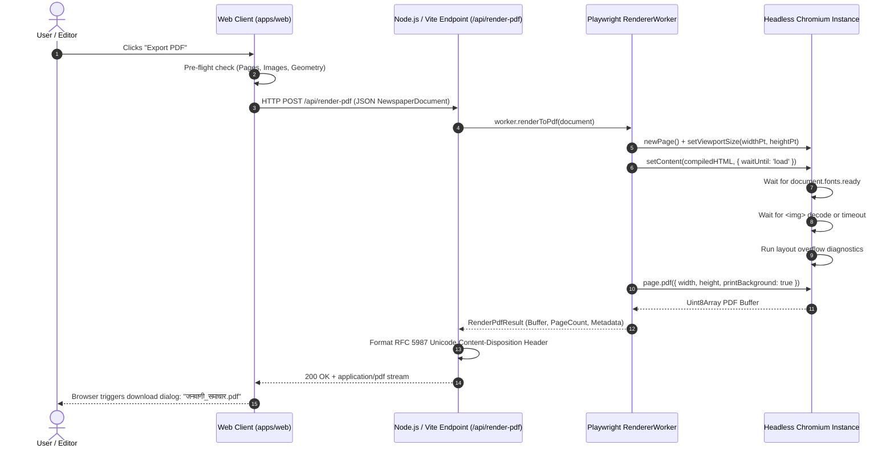

# E-PAPER STUDIO — PDF EXPORT ARCHITECTURE

## 1. Architectural Overview

E-Paper Studio produces commercial-grade, multi-page, vector PDF publications by bridging the structured document schema directly with a headless Playwright Chromium rendering engine.



---

## 2. Rendering Lifecycle & Guarantees

### 2.1 Physical Page Boxes & MediaBox Assertions

- `page.pdf()` options must strictly define explicit dimensions matching the document's physical paper format:
  ```typescript
  await page.pdf({
    width: `${widthIn}in`,
    height: `${heightIn}in`,
    printBackground: true,
    margin: { top: '0in', right: '0in', bottom: '0in', left: '0in' },
    preferCSSPageSize: true,
  });
  ```
- Resulting MediaBoxes in the binary stream must match the designated point dimensions within 0.1 pt accuracy.

### 2.2 Typographic Font Resolution

- Devanagari typography relies on external Open Font License (OFL) font files served via Google Fonts CDN.
- The worker evaluates `document.fonts.ready` before rasterization to guarantee all glyphs, vowel matras, and conjunct shaping tables are active.
- Timeout protection: A maximum wait of 3,000ms prevents worker deadlock if network conditions degrade.

### 2.3 Image Handling & SSRF Protection

- Outbound network requests inside the Chromium instance are intercepted via `page.route('**/*')`.
- All requests are scrutinized against `isSafeUrl()`. Localhost (`127.0.0.1`, `localhost`, `::1`), link-local metadata addresses (`169.254.169.254`), and private RFC 1918 subnets (`10.*`, `192.168.*`, `172.16.*`) are immediately blocked (`route.abort('blockedbyclient')`).
- Inline `data:image/` URLs and safe public HTTPS URLs are permitted.

---

## 3. Unicode HTTP Header Compliance (RFC 5987 / RFC 6266)

To avoid Node.js runtime `TypeError [ERR_INVALID_CHAR]: Invalid character in header content ["Content-Disposition"]` when exporting documents with native Devanagari titles (such as _जनवाणी समाचार_ or _दैनिक नवप्रभात_), the server formats headers according to international web standards:

```typescript
const asciiTitle =
  (document.metadata?.title || 'newspaper')
    .replace(/[^a-zA-Z0-9_-]/g, '_')
    .replace(/^_+|_+$/g, '') || 'newspaper';

const asciiFilename = `${asciiTitle}.pdf`;
const fullFilename = `${(document.metadata?.title || 'newspaper').replace(/[^\p{L}\p{N}_-]+/gu, '_')}.pdf`;
const utf8Filename = encodeURIComponent(fullFilename);

res.setHeader('Content-Type', 'application/pdf');
res.setHeader('Content-Length', result.fileSizeBytes);
res.setHeader(
  'Content-Disposition',
  `attachment; filename="${asciiFilename}"; filename*=UTF-8''${utf8Filename}`
);
```

---

## 4. Multi-Page Ordering & Inside Page Folios

- **Page 1**: Renders the complete, ornate front-page Masthead with issue particulars, weather/price ears, and primary headlines.
- **Pages 2 through N**: The front-page masthead is replaced by a formal inside folio header:
  `"जनवाणी समाचार • पृष्ठ 2 • मंगलवार, 27 अक्टूबर 2026 • संपादकीय एवं विचार"`
- **Page Break Isolation**: Each page element in the HTML template enforces CSS print page break rules:
  ```css
  .newspaper-page {
    page-break-after: always;
    break-after: page;
    box-sizing: border-box;
    overflow: hidden;
  }
  .newspaper-page:last-child {
    page-break-after: avoid;
    break-after: avoid;
  }
  ```
