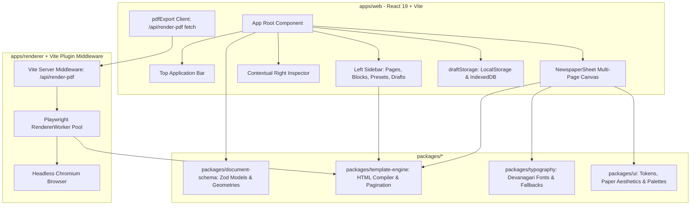

# E-PAPER STUDIO — SYSTEM ARCHITECTURE SPECIFICATION

## 1. High-Level Architecture

E-Paper Studio operates as a modular, type-safe monorepo utilizing pnpm workspaces, React 19, TypeScript (strict mode), Vite, and Playwright Chromium for deterministic vector PDF synthesis.

---

## 2. Package Roles & Boundary Responsibilities

### 2.1 `@epaper-studio/document-schema`

- **Responsibility**: Single source of truth for all data definitions.
- **Key Schemas**:
  - `NewspaperDocumentSchema`: Full publication model with metadata, masthead, layout config, and article/block hierarchy.
  - `NewspaperPageSchema`: Discrete multi-page model supporting per-page blocks, interior folios, and custom dimensions.
  - `PAGE_SIZE_DEFINITIONS`: Mathematical point specifications for Broadsheet, Berliner, Tabloid, A3, and A4.
  - `ArticleSchema` & `NewspaperBlockSchema`: Editorial content attributes, column spans, priority, and imagery.

### 2.2 `@epaper-studio/typography`

- **Responsibility**: Font catalog definitions, optical weight calculations, Google Fonts Devanagari CSS URLs, and recommended Indian typography pairings.
- **Key Assets**:
  - 8 Verified Open Font License (OFL) Devanagari families: Noto Serif Devanagari, Noto Sans Devanagari, Mukta, Hind, Rozha One, Yatra One, Gotu, Tiro Devanagari Hindi.
  - Script-specific rules: Disabling Western drop caps on Hindi text to preserve complex conjuncts and prevent matra detachment.

### 2.3 `@epaper-studio/template-engine`

- **Responsibility**: Layout compilation, article partitioning across pages, pagination calculations, volume estimation, and generation of self-contained HTML for PDF rendering.
- **Key Functions**:
  - `createNewspaperDocument()`: Factory for new publication documents with seed content.
  - `renderNewspaperDocumentToHtml()`: Produces deterministic, styled HTML including CSS `@page` sizing, column dividing rules, mastheads, and inside page folios.
  - `partitionArticlesForPages()`: Divides content across multiple pages based on physical page capacity budgets.
  - `getPageDimensionsPt()`: Computes exact point and inch dimensions for any paper size and orientation.

### 2.4 `apps/web`

- **Responsibility**: The user-facing publishing studio built with React 19.
- **Key Architectural Decisions**:
  - English-first UI controls, Hindi-first default publication content.
  - Debounced autosave mechanism with visual status indicators.
  - Unsaved-changes browser protection via `beforeunload`.
  - Responsive design supporting Desktop, Tablet, and Mobile touch editing.

### 2.5 `apps/renderer` & Server Plugin

- **Responsibility**: Playwright-based headless Chromium PDF generation service.
- **Key Architectural Decisions**:
  - Embedded as a Vite dev/preview server middleware (`/api/render-pdf`) and standalone Node.js service for production deployment.
  - SSRF Protection: Intercepts all network requests within Chromium, blocking loopback (localhost, 127.0.0.1, ::1) and link-local cloud metadata endpoints (169.254.169.254).
  - RFC 5987 / RFC 6266 Compliance: Uses formatted UTF-8 `Content-Disposition` headers to deliver files with native Devanagari names without Node.js `ERR_INVALID_CHAR` HTTP header crashes.

---

## 3. Data Flow & State Management

1. **Publication State**:
   - Single root state `document: NewspaperDocument` maintained in `App.tsx`.
   - Mutated via immutable update handlers (`handleUpdateArticle`, `handleAddArticle`, `handleDeleteArticle`, `handleUpdateMasthead`, `handleUpdateLayout`, `handleSelectPage`).
2. **Selection State**:
   - `selectedArticleId: string | null`: Identifies the block currently highlighted on the canvas and bound to the contextual inspector.
   - `activePageIndex: number`: Identifies which page of a multi-page publication is currently rendered in the main canvas view.
3. **Persistence Strategy**:
   - `draftStorage` abstraction: Uses `localStorage` with JSON serialization and versioned schema checking.
   - Autosave interval: Triggers 1.5 seconds after the user stops typing, updating `savedAt` timestamp and clearing `hasUnsavedChanges`.

---

## 4. Security & Safety Boundaries

1. **XSS & Style Injection Mitigation**:
   - All user inputs (headlines, body, captions, masthead metadata) pass through `escapeHtml()` before string interpolation into the PDF HTML template.
   - CSS values (font families, sizes, colors) pass through `sanitizeCssValue()` stripping semicolons, curly braces, and script tokens.
2. **SSRF Mitigation**:
   - Chromium page route handler validates all outbound image URLs against `isSafeUrl()`, rejecting private LAN ranges, cloud metadata IPs, and non-HTTP protocols.
3. **Memory & Concurrency Management**:
   - Single persistent browser instance reused across render jobs; pages closed in `finally` blocks to prevent Chromium process leaks.
