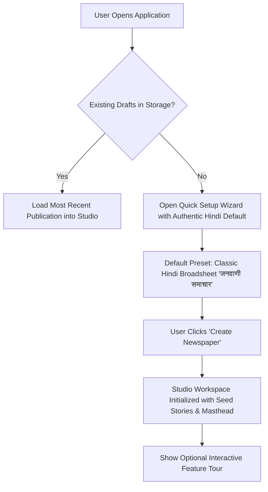
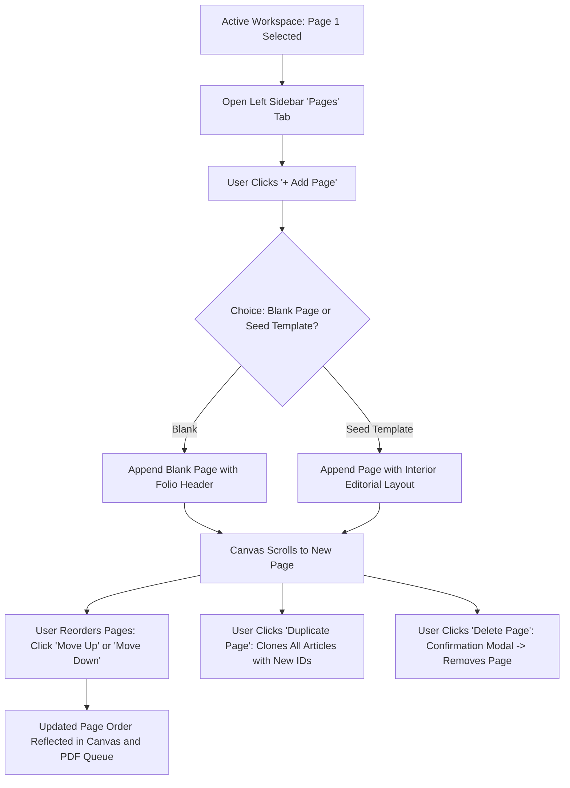
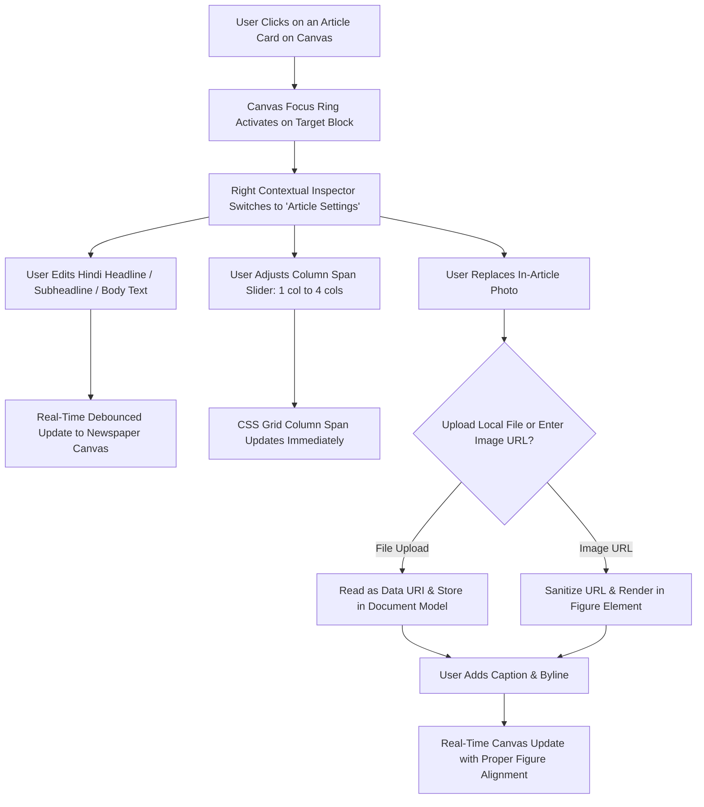
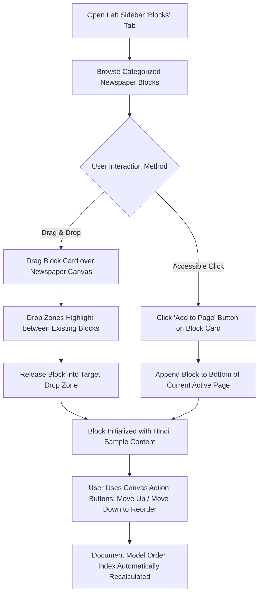

# E-PAPER STUDIO — USER FLOWS & INTERACTION JOURNEYS

## 1. Flow Overview & Journeys

This document defines the primary user interaction flows for creating, editing, organizing, and publishing Indian newspapers in E-Paper Studio.

---

## 2. Core User Flows

### Flow 1: First-Time Onboarding & Quick Creation



### Flow 2: Multi-Page Management Journey



### Flow 3: Content Editing & Contextual Inspector Flow



### Flow 4: Block Insertion & Drag-and-Drop / Reordering Flow



### Flow 5: Full Publication PDF Export Journey

```mermaid
graph TD
    A[User Clicks 'Export PDF' in Top Bar] --> B[Client Pre-flight Validation: Check Page Count & Image Safety]
    B --> C[Show Loading Spinner & Progress Status in UI]
    C --> D[Send Full Multi-Page Document Model to /api/render-pdf]
    D --> E[Headless Playwright Chromium Launches]
    E --> F[Set Exact Physical Viewport: Points & MediaBox]
    F --> G[Inject HTML Template with Web Fonts & CSS Grid]
    G --> H[Wait for document.fonts.ready & Image Decoding]
    H --> I[Chromium Print Engine Generates Vector PDF Buffer]
    I --> J[Set RFC 5987 / RFC 6266 Unicode Filename Headers]
    J --> K[Return Binary Buffer to Client with 200 OK]
    K --> L[Client Triggers Native Browser File Download]
    L --> M[Show Success Toast: 'Downloaded Janwani_Samachar.pdf (X KB)']
```

### Flow 6: Error Recovery & Edge Case Journeys

1. **Typographic Overflow Warning Flow**:
   - As body text expands, real-time volume estimator tracks word budget.
   - If estimated words exceed physical page threshold (> 4,000 for Broadsheet, > 2,200 for Tabloid), a non-blocking Amber Warning banner appears above the canvas.
   - User actions provided:
     - Shorten text manually.
     - Reduce body font size (e.g. from 10.5pt to 9.5pt).
     - Move article to subsequent page via "Move to Page" dropdown.
     - Add a new page to the publication.

2. **Unsaved Edits Protection Flow**:
   - If user attempts to close the tab or navigate away while `hasUnsavedChanges === true`:
     - Browser prompts native `beforeunload` dialog: _"Changes you made may not be saved."_
   - Autosave interval runs every 3 seconds of idle time, minimizing data loss risk to zero.

3. **PDF Export Error Recovery Flow**:
   - If server worker times out or network connection fails:
     - Error banner displays human-readable diagnostic message.
     - Clear retry action button provided without reloading the page or losing edits.
